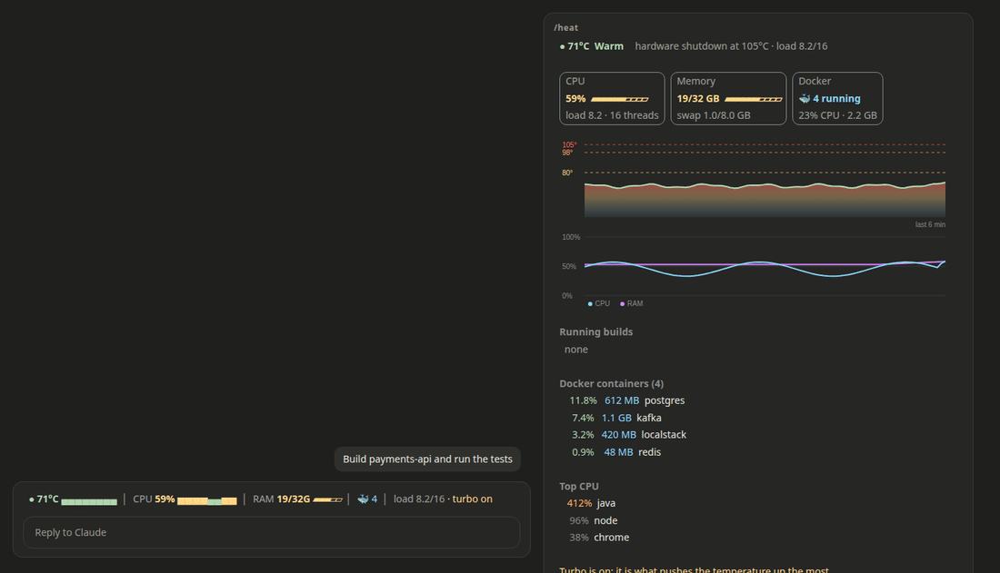

# heat-gate

A [Claude Code](https://code.claude.com) mod that keeps parallel sessions from cooking your laptop.

When several Claude Code sessions run Gradle, Maven, Cargo or Docker builds at the same time, a laptop can hit its critical temperature and shut down without warning. heat-gate watches the CPU temperature and turns heavy builds into a queue shared by every session.



*The CPU climbs past 80°C, Claude asks for `./gradlew build`, heat-gate queues it, and the build starts on its own once the CPU is below 75°C. On the right, the `/heat` pane.*

## What it does

- **Band above the prompt** with the CPU temperature and CPU use, each with its own small chart, the memory in use, the running Docker containers, the load, whether turbo boost is on and the builds that are running.
- **Shared build queue.** A heavy command waits when the CPU is at or above 80°C, when another build is already running or when one has just started. Queued builds start on their own once the CPU drops below 75°C. While a build waits you can press `1` to run it now or `2` to cancel it. After 30 minutes in the queue it is refused.
- **Emergency freeze.** At 98°C the build processes are paused with `SIGSTOP` and resumed with `SIGCONT` below 82°C, so a runaway build cannot take the machine down.
- **`/heat` pane** with CPU, memory (and swap) and Docker tiles, a temperature chart and a CPU and memory chart (SVG in the desktop app, text in the terminal), each container with its CPU and memory, the builds, the queue, the processes using the most CPU, a manual freeze button and the command to turn turbo boost off.
- **Light on the machine.** One session reads the sensors every 4 seconds and the containers every 2 minutes, and every other session reuses that reading, so opening more sessions adds no load.

Heavy commands are Gradle and Maven tasks such as `build`, `test` or `bootRun`, `cargo build|test|bench|run`, `go build|test`, `npm|pnpm|yarn|bun` builds and tests, `docker build`, `docker compose up` and `bazel build|test`. You can add your own.

If the mod itself fails, the command runs as usual: heat-gate never blocks your work because of a bug of its own.

## Using it

- The band sits above the prompt in every session as soon as the mod is installed. It shows the temperature with its trend, the CPU use, the memory, the containers, the load and turbo, plus a line for every build that is running.
- When a build is held, the band turns into a card with the reason (`CPU at 83°C`, `another build running (payments-api)`, `turn 2 of 3 in the queue`) and two buttons: **Run now** starts it at once, **Cancel** refuses it and tells Claude not to retry on its own.
- `/heat` opens the pane with the full picture. It also opens by itself while a build is held.
- Claude sees nothing unusual: a held command simply takes longer to start. A cancelled or timed out command comes back as refused with the reason, so Claude can tell you instead of looping.

## How the queue decides

A heavy command starts at once when the CPU is below `hold_above`, no build is running on the machine, none has started in the last 45 seconds and nothing is queued ahead of it. Otherwise it waits, checks again every 3 seconds and starts once the CPU is below `release_below` and it is first in line. The queue lives in the plugin store, so sessions started from different terminals or the desktop app take turns in order.

The emergency freeze only touches build processes: Gradle daemons and workers, Gradle test executors, Maven and `rustc`/`cargo`. Your editor, browser and containers are never paused.

## Requirements

- Linux. The temperature comes from `/sys/class/hwmon` (`k10temp`, `zenpower` or `coretemp`) and `/sys/class/thermal`. CPU and memory come from `/proc/stat` and `/proc/meminfo`.
- Docker is optional: without it the container figures are hidden.
- Claude Code 2.1.287 or later in the terminal, or 2.1.286 or later in the Code tab of the desktop app.

## Install

```bash
claude plugin marketplace add enzovalley9/heat-gate
claude plugin install heat-gate@heat-gate
```

In a session that is already open, `/reload-plugins` loads it without a restart.

## Options

Set them in `/plugin`, or pass `--config KEY=VALUE` to `claude plugin install`.

| Option | Default | Meaning |
| --- | --- | --- |
| `language` | `en` | `en` or `es` |
| `hold_above` | `80` | A heavy build waits when the CPU is at or above this temperature (°C) |
| `release_below` | `75` | A queued build starts below this temperature when no other build runs |
| `freeze_enabled` | `true` | Pause builds with `SIGSTOP` close to a thermal shutdown |
| `freeze_at` | `98` | Temperature that triggers the freeze |
| `thaw_below` | `82` | Frozen builds resume below this temperature |
| `max_wait_minutes` | `30` | A queued build is refused after waiting this long |
| `extra_build_pattern` | empty | Regular expression for more heavy commands, for example `make -j\|ninja` |

## Uninstall

```bash
claude plugin uninstall heat-gate@heat-gate
```

If a freeze was active when the mod was removed, resume the builds with `pkill -CONT -f GradleDaemon` (or the process you need).

## Tests

```bash
claude plugin test
claude plugin validate
```

The tests drive the hooks with fake sensors, so they pass on any machine.

## License

[MIT](LICENSE)
